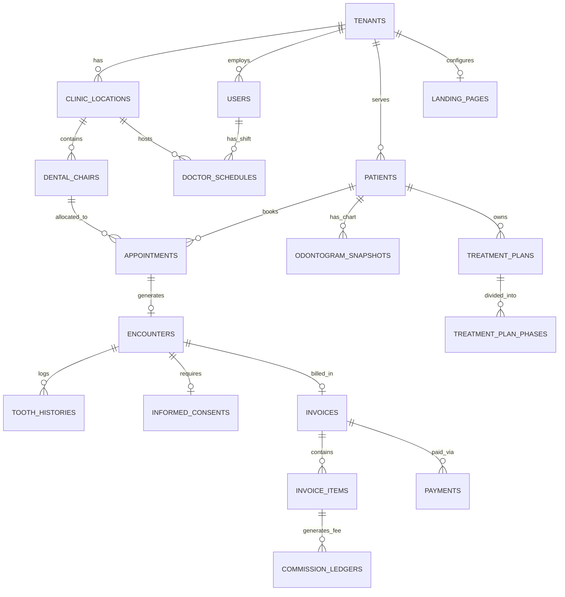

# 02 - Database Schema & Entity Relationship Diagram (PostgreSQL)

Arsitektur database menggunakan **PostgreSQL** dengan memanfaatkan fitur spesifik:
- **`JSONB`**: Menyimpan *snapshot* visual Odontogram, konfigurasi blok Landing Page, dan *medical alerts* agar *query* sangat cepat tanpa *JOIN* berlebih.
- **`tstzrange` & `EXCLUDE USING gist`**: Mencegah *double-booking* pada kursi gigi maupun dokter di level database.

---

## 1. Entity Relationship Diagram (Mermaid)



---

## 2. Core PostgreSQL DDL Schema

```sql
-- Aktifkan ekstensi untuk UUID dan GIST Index (Anti Double-Booking)
CREATE EXTENSION IF NOT EXISTS "pgcrypto";
CREATE EXTENSION IF NOT EXISTS "btree_gist";

-- ==========================================
-- 1. MULTI-TENANCY, LOCATIONS & RESOURCES
-- ==========================================
CREATE TABLE tenants (
    id UUID PRIMARY KEY DEFAULT gen_random_uuid(),
    name VARCHAR(150) NOT NULL,
    slug VARCHAR(100) UNIQUE NOT NULL, -- untuk subdomain: slug.domain.com
    custom_domain VARCHAR(150) UNIQUE,
    mode VARCHAR(20) NOT NULL DEFAULT 'CLINIC' CHECK (mode IN ('SOLO', 'CLINIC')),
    subscription_tier VARCHAR(30) DEFAULT 'STARTER',
    created_at TIMESTAMPTZ DEFAULT NOW()
);

CREATE TABLE clinic_locations (
    id UUID PRIMARY KEY DEFAULT gen_random_uuid(),
    tenant_id UUID NOT NULL REFERENCES tenants(id) ON DELETE CASCADE,
    name VARCHAR(150) NOT NULL, -- Dokter Solo bisa punya >1 lokasi tempat ia praktik
    address TEXT,
    google_maps_url TEXT,
    phone_whatsapp VARCHAR(30),
    is_active BOOLEAN DEFAULT TRUE
);

CREATE TABLE dental_chairs (
    id UUID PRIMARY KEY DEFAULT gen_random_uuid(),
    location_id UUID NOT NULL REFERENCES clinic_locations(id) ON DELETE CASCADE,
    name VARCHAR(50) NOT NULL, -- contoh: "Kursi 1 - Lantai 1"
    is_active BOOLEAN DEFAULT TRUE
);

CREATE TABLE users (
    id UUID PRIMARY KEY DEFAULT gen_random_uuid(),
    tenant_id UUID NOT NULL REFERENCES tenants(id) ON DELETE CASCADE,
    role VARCHAR(30) NOT NULL CHECK (role IN ('OWNER', 'DOCTOR', 'NURSE', 'CASHIER')),
    full_name VARCHAR(150) NOT NULL,
    title_prefix VARCHAR(30), -- contoh: "drg."
    title_suffix VARCHAR(50), -- contoh: "Sp.KG"
    sip_number VARCHAR(100),
    str_number VARCHAR(100),
    phone VARCHAR(30),
    email VARCHAR(150) UNIQUE NOT NULL,
    avatar_url TEXT,
    is_active BOOLEAN DEFAULT TRUE
);

-- ==========================================
-- 2. SERVICES CATALOG & COMMISSION RULES
-- ==========================================
CREATE TABLE services_catalog (
    id UUID PRIMARY KEY DEFAULT gen_random_uuid(),
    tenant_id UUID NOT NULL REFERENCES tenants(id) ON DELETE CASCADE,
    code VARCHAR(30),
    clinical_name VARCHAR(150) NOT NULL, -- contoh: "Restorasi Komposit Kelas II"
    layman_name VARCHAR(150) NOT NULL,   -- contoh: "Tambal Gigi Berlubang"
    category VARCHAR(50) NOT NULL,       -- SCALING, FILLING, EXTRACTION, ORTHO, AESTHETIC
    duration_minutes INT NOT NULL DEFAULT 30,
    buffer_minutes INT NOT NULL DEFAULT 10, -- waktu sterilisasi kursi
    base_price NUMERIC(12,2) NOT NULL DEFAULT 0,
    default_material_cost NUMERIC(12,2) DEFAULT 0, -- potongan modal bahan sebelum komisi
    requires_tooth_number BOOLEAN DEFAULT TRUE,
    requires_informed_consent BOOLEAN DEFAULT FALSE,
    is_bookable_online BOOLEAN DEFAULT TRUE
);

CREATE TABLE commission_rules (
    id UUID PRIMARY KEY DEFAULT gen_random_uuid(),
    tenant_id UUID NOT NULL REFERENCES tenants(id) ON DELETE CASCADE,
    doctor_id UUID REFERENCES users(id) ON DELETE CASCADE, -- NULL = berlaku untuk semua dokter
    service_id UUID REFERENCES services_catalog(id) ON DELETE CASCADE, -- NULL = aturan default
    calculation_basis VARCHAR(20) NOT NULL DEFAULT 'NET' CHECK (calculation_basis IN ('GROSS', 'NET')),
    commission_type VARCHAR(20) NOT NULL DEFAULT 'PERCENTAGE' CHECK (commission_type IN ('PERCENTAGE', 'FLAT')),
    commission_value NUMERIC(12,2) NOT NULL, -- contoh: 40.00 (40%) atau 50000 (Flat)
    deduct_promo_from_doctor BOOLEAN DEFAULT FALSE
);

-- ==========================================
-- 3. PATIENTS & PRE-VISIT DIGITAL INTAKE
-- ==========================================
CREATE TABLE patients (
    id UUID PRIMARY KEY DEFAULT gen_random_uuid(),
    tenant_id UUID NOT NULL REFERENCES tenants(id) ON DELETE CASCADE,
    medical_record_number VARCHAR(50) NOT NULL,
    nik VARCHAR(16), -- Disiapkan untuk kesiapan data rekam medis nasional
    full_name VARCHAR(150) NOT NULL,
    date_of_birth DATE,
    gender VARCHAR(10),
    phone_whatsapp VARCHAR(30) NOT NULL,
    -- Medical Alerts tampil sebagai badge merah di layar dokter
    medical_alerts JSONB DEFAULT '{"allergies": [], "systemic_conditions": [], "is_pregnant": false}'::jsonb,
    last_scaling_date DATE,
    created_at TIMESTAMPTZ DEFAULT NOW(),
    UNIQUE(tenant_id, medical_record_number)
);

-- ==========================================
-- 4. SMART SCHEDULING & APPOINTMENTS
-- ==========================================
CREATE TABLE doctor_schedules (
    id UUID PRIMARY KEY DEFAULT gen_random_uuid(),
    tenant_id UUID NOT NULL REFERENCES tenants(id) ON DELETE CASCADE,
    doctor_id UUID NOT NULL REFERENCES users(id) ON DELETE CASCADE,
    location_id UUID NOT NULL REFERENCES clinic_locations(id) ON DELETE CASCADE,
    default_chair_id UUID REFERENCES dental_chairs(id),
    day_of_week INT NOT NULL CHECK (day_of_week BETWEEN 0 AND 6), -- 0=Minggu .. 6=Sabtu
    start_time TIME NOT NULL,
    end_time TIME NOT NULL,
    sitting_fee NUMERIC(12,2) DEFAULT 0 -- Uang duduk per shift
);

CREATE TABLE appointments (
    id UUID PRIMARY KEY DEFAULT gen_random_uuid(),
    tenant_id UUID NOT NULL REFERENCES tenants(id) ON DELETE CASCADE,
    location_id UUID NOT NULL REFERENCES clinic_locations(id),
    patient_id UUID NOT NULL REFERENCES patients(id),
    doctor_id UUID NOT NULL REFERENCES users(id),
    chair_id UUID NOT NULL REFERENCES dental_chairs(id),
    service_id UUID REFERENCES services_catalog(id),
    time_slot TSTZRANGE NOT NULL, -- Rentang waktu [start, end) termasuk buffer sterilisasi
    status VARCHAR(30) NOT NULL DEFAULT 'BOOKED' 
        CHECK (status IN ('PENDING_DEPOSIT', 'BOOKED', 'CONFIRMED', 'ARRIVED', 'IN_CHAIR', 'COMPLETED', 'CANCELLED', 'NO_SHOW')),
    arrived_at TIMESTAMPTZ, -- Untuk menghitung live waiting timer di UI
    deposit_amount NUMERIC(12,2) DEFAULT 0,
    deposit_paid BOOLEAN DEFAULT FALSE,
    booking_source VARCHAR(30) DEFAULT 'LANDING_PAGE', -- LANDING_PAGE, WALK_IN, WHATSAPP, RECALL
    notes TEXT,
    -- Proteksi level database: Kursi yang sama tidak bisa dipakai di waktu yang beririsan
    EXCLUDE USING gist (
        chair_id WITH =,
        time_slot WITH &&
    ) WHERE (status NOT IN ('CANCELLED', 'NO_SHOW')),
    -- Proteksi level database: Dokter yang sama tidak bisa praktik di 2 kursi/lokasi bersamaan
    EXCLUDE USING gist (
        doctor_id WITH =,
        time_slot WITH &&
    ) WHERE (status NOT IN ('CANCELLED', 'NO_SHOW'))
);

-- ==========================================
-- 5. CLINICAL WORKSPACE, ODONTOGRAM & PLANS
-- ==========================================
CREATE TABLE encounters (
    id UUID PRIMARY KEY DEFAULT gen_random_uuid(),
    tenant_id UUID NOT NULL REFERENCES tenants(id) ON DELETE CASCADE,
    appointment_id UUID UNIQUE REFERENCES appointments(id),
    patient_id UUID NOT NULL REFERENCES patients(id),
    doctor_id UUID NOT NULL REFERENCES users(id),
    nurse_id UUID REFERENCES users(id),
    blood_pressure VARCHAR(20),
    subjective_notes TEXT,
    objective_notes TEXT,
    assessment_notes TEXT,
    plan_notes TEXT,
    clinical_photos JSONB DEFAULT '[]'::jsonb, -- Array URL foto Before/After & Rontgen
    created_at TIMESTAMPTZ DEFAULT NOW()
);

-- Menyimpan state visual Odontogram per pasien & snapshot per kunjungan
CREATE TABLE patient_odontogram_snapshots (
    id UUID PRIMARY KEY DEFAULT gen_random_uuid(),
    patient_id UUID NOT NULL REFERENCES patients(id) ON DELETE CASCADE,
    encounter_id UUID REFERENCES encounters(id) ON DELETE SET NULL,
    dentition_type VARCHAR(20) DEFAULT 'ADULT' CHECK (dentition_type IN ('ADULT', 'PEDIATRIC', 'MIXED')),
    chart_data JSONB NOT NULL, -- State lengkap FDI 11-48 & 51-85
    updated_at TIMESTAMPTZ DEFAULT NOW()
);

-- Tabel relasional untuk riwayat per nomor gigi (Audit Trail)
CREATE TABLE tooth_clinical_histories (
    id UUID PRIMARY KEY DEFAULT gen_random_uuid(),
    tenant_id UUID NOT NULL REFERENCES tenants(id) ON DELETE CASCADE,
    patient_id UUID NOT NULL REFERENCES patients(id) ON DELETE CASCADE,
    encounter_id UUID REFERENCES encounters(id) ON DELETE CASCADE,
    tooth_number INT NOT NULL, -- FDI: 11..48 atau 51..85
    surfaces VARCHAR(10)[],    -- contoh: ARRAY['M', 'O']
    condition_code VARCHAR(50) NOT NULL, -- CARIES_DENTIN, PULPITIS, MISSING, dll.
    layer_status VARCHAR(20) NOT NULL CHECK (layer_status IN ('EXISTING', 'PATHOLOGY', 'PLANNED', 'COMPLETED')),
    service_id UUID REFERENCES services_catalog(id),
    doctor_id UUID REFERENCES users(id),
    notes TEXT,
    recorded_at TIMESTAMPTZ DEFAULT NOW()
);

CREATE TABLE informed_consents (
    id UUID PRIMARY KEY DEFAULT gen_random_uuid(),
    encounter_id UUID NOT NULL REFERENCES encounters(id) ON DELETE CASCADE,
    patient_id UUID NOT NULL REFERENCES patients(id),
    doctor_id UUID NOT NULL REFERENCES users(id),
    consent_type VARCHAR(20) DEFAULT 'APPROVAL' CHECK (consent_type IN ('APPROVAL', 'REFUSAL')),
    procedure_summary TEXT NOT NULL,
    risks_explained TEXT NOT NULL,
    patient_signature_url TEXT NOT NULL,
    witness_name VARCHAR(150),
    witness_signature_url TEXT,
    signed_at TIMESTAMPTZ DEFAULT NOW()
);

CREATE TABLE treatment_plans (
    id UUID PRIMARY KEY DEFAULT gen_random_uuid(),
    tenant_id UUID NOT NULL REFERENCES tenants(id) ON DELETE CASCADE,
    patient_id UUID NOT NULL REFERENCES patients(id) ON DELETE CASCADE,
    doctor_id UUID NOT NULL REFERENCES users(id),
    title VARCHAR(150) NOT NULL, -- contoh: "Perawatan Saluran Akar Gigi 36"
    status VARCHAR(20) DEFAULT 'ACTIVE' CHECK (status IN ('DRAFT', 'ACTIVE', 'COMPLETED', 'CANCELLED')),
    created_at TIMESTAMPTZ DEFAULT NOW()
);

CREATE TABLE treatment_plan_phases (
    id UUID PRIMARY KEY DEFAULT gen_random_uuid(),
    plan_id UUID NOT NULL REFERENCES treatment_plans(id) ON DELETE CASCADE,
    phase_order INT NOT NULL, -- Kunjungan ke-1, 2, 3
    tooth_number INT,
    service_id UUID NOT NULL REFERENCES services_catalog(id),
    estimated_price NUMERIC(12,2) NOT NULL,
    recommended_interval_days INT DEFAULT 7, -- Jarak hari ke kunjungan berikutnya
    linked_appointment_id UUID REFERENCES appointments(id),
    status VARCHAR(20) DEFAULT 'PENDING' CHECK (status IN ('PENDING', 'SCHEDULED', 'DONE'))
);

-- ==========================================
-- 6. BILLING, INSTALLMENTS, LAB & COMMISSIONS
-- ==========================================
CREATE TABLE dental_lab_orders (
    id UUID PRIMARY KEY DEFAULT gen_random_uuid(),
    tenant_id UUID NOT NULL REFERENCES tenants(id) ON DELETE CASCADE,
    encounter_id UUID NOT NULL REFERENCES encounters(id),
    patient_id UUID NOT NULL REFERENCES patients(id),
    lab_vendor_name VARCHAR(150) NOT NULL,
    work_type VARCHAR(150) NOT NULL, -- contoh: "Crown Zirconia Gigi 21"
    shade_color VARCHAR(30),         -- contoh: "A2"
    lab_cost NUMERIC(12,2) NOT NULL DEFAULT 0,
    sent_date DATE,
    expected_return_date DATE,
    status VARCHAR(30) DEFAULT 'ORDERED' CHECK (status IN ('ORDERED', 'SENT', 'RECEIVED', 'FITTED'))
);

CREATE TABLE invoices (
    id UUID PRIMARY KEY DEFAULT gen_random_uuid(),
    tenant_id UUID NOT NULL REFERENCES tenants(id) ON DELETE CASCADE,
    invoice_number VARCHAR(50) UNIQUE NOT NULL,
    encounter_id UUID REFERENCES encounters(id),
    patient_id UUID NOT NULL REFERENCES patients(id),
    subtotal NUMERIC(12,2) NOT NULL DEFAULT 0,
    discount_amount NUMERIC(12,2) NOT NULL DEFAULT 0,
    deposit_deducted NUMERIC(12,2) NOT NULL DEFAULT 0,
    grand_total NUMERIC(12,2) NOT NULL DEFAULT 0,
    amount_paid NUMERIC(12,2) NOT NULL DEFAULT 0,
    payment_status VARCHAR(20) DEFAULT 'UNPAID' CHECK (payment_status IN ('UNPAID', 'PARTIAL', 'PAID')),
    created_at TIMESTAMPTZ DEFAULT NOW()
);

-- Penting: doctor_id & nurse_id wajib berada di level baris item, bukan di header invoice!
CREATE TABLE invoice_items (
    id UUID PRIMARY KEY DEFAULT gen_random_uuid(),
    invoice_id UUID NOT NULL REFERENCES invoices(id) ON DELETE CASCADE,
    service_id UUID REFERENCES services_catalog(id),
    tooth_number INT,
    performed_by_doctor_id UUID NOT NULL REFERENCES users(id),
    assisted_by_nurse_id UUID REFERENCES users(id),
    quantity INT NOT NULL DEFAULT 1,
    unit_price NUMERIC(12,2) NOT NULL,
    item_discount NUMERIC(12,2) DEFAULT 0,
    material_cost_deduction NUMERIC(12,2) DEFAULT 0,
    lab_order_id UUID REFERENCES dental_lab_orders(id),
    lab_cost_deduction NUMERIC(12,2) DEFAULT 0,
    line_total NUMERIC(12,2) NOT NULL
);

CREATE TABLE payments (
    id UUID PRIMARY KEY DEFAULT gen_random_uuid(),
    invoice_id UUID NOT NULL REFERENCES invoices(id) ON DELETE CASCADE,
    amount NUMERIC(12,2) NOT NULL,
    payment_method VARCHAR(30) NOT NULL CHECK (payment_method IN ('CASH', 'QRIS', 'DEBIT', 'CREDIT', 'TRANSFER')),
    paid_at TIMESTAMPTZ DEFAULT NOW()
);

CREATE TABLE commission_ledgers (
    id UUID PRIMARY KEY DEFAULT gen_random_uuid(),
    tenant_id UUID NOT NULL REFERENCES tenants(id) ON DELETE CASCADE,
    invoice_item_id UUID NOT NULL REFERENCES invoice_items(id) ON DELETE CASCADE,
    doctor_id UUID NOT NULL REFERENCES users(id),
    base_calculation_amount NUMERIC(12,2) NOT NULL, -- Nilai bersih setelah dipotong Lab/Bahan
    total_commission_earned NUMERIC(12,2) NOT NULL, -- Total hak komisi jika lunas 100%
    releasable_commission NUMERIC(12,2) NOT NULL,   -- Komisi cair proporsional sesuai cicilan masuk
    payout_status VARCHAR(20) DEFAULT 'UNSETTLED' CHECK (payout_status IN ('UNSETTLED', 'SETTLED')),
    settled_at TIMESTAMPTZ
);
```
