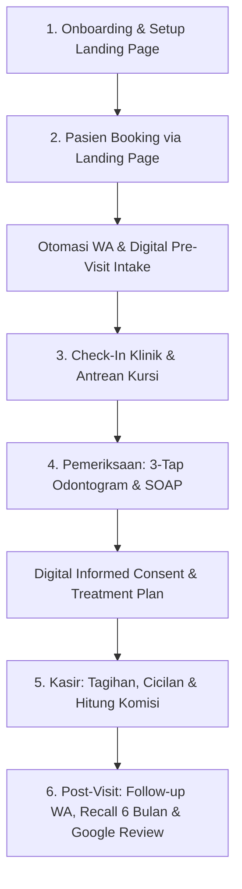

# 01 - Product Requirements Document (PRD) & End-to-End Flows
**Project Name:** Dental SaaS Platform (Front-Office Acquisition + Back-Office Clinical & Operations)  
**Target Market:** Praktik Mandiri Dokter Gigi (Solo) & Klinik Gigi Multi-Dokter/Cabang (Indonesia)  
**Scope Note:** Integrasi SATUSEHAT ditangguhkan ke Fase Berikutnya (skema data tetap disiapkan agar *future-proof*).

---

## 1. Visi Produk & Unique Selling Proposition (USP)
Mayoritas software klinik gigi lokal hanya berfungsi sebagai "alat catat" administrasi yang kaku. Platform ini memposisikan diri sebagai **Mesin Pertumbuhan & Operasional Klinik Gigi** dengan menggabungkan:
1. **Front-Office (Akuisisi & Retensi):** No-Code Dental Landing Page Builder, Smart Chair-Doctor Booking, Digital Pre-Visit Intake, dan WhatsApp Recall Otomatis.
2. **Clinical Workspace (Ruang Tindakan):** UI/UX ramah sarung tangan medis (*Gloved-Hand Friendly*), *3-Tap Odontogram-to-Billing*, *Multi-Visit Treatment Plan*, dan *Digital Informed Consent*.
3. **Back-Office (Keuangan Anti-Sengketa):** Kasir dengan dukungan cicilan (*instalment*), pelacakan *Dental Lab*, dan mesin hitung komisi dokter otomatis berbasis *Net Collection*.

---

## 2. Aktor & Role-Based Access Control (RBAC)

| Role | Deskripsi & Hak Akses Utama |
| :--- | :--- |
| **Owner / Super Admin Klinik** | Mengatur cabang, kursi gigi (*dental unit*), katalog tindakan, aturan komisi dokter, laporan keuangan, dan *Landing Page Builder*. |
| **Dokter Gigi (Associate)** | Mengakses jadwal pribadi, RME & Odontogram, membuat *Treatment Plan*, *Informed Consent*, serta melihat dashboard komisi pribadi. |
| **Perawat Gigi (Dental Assistant)** | Menginput *vital signs* awal, membantu pencatatan Odontogram/SOAP, mencatat pemakaian BMHP (bahan habis pakai), dan *order* Lab Gigi. |
| **Resepsionis / Kasir (Front-Desk)** | Mengelola kalender *Chair-Grid*, registrasi *walk-in*, *check-in* antrean, penagihan kasir, dan penjadwalan kunjungan ulang. |
| **Dokter Praktik Mandiri (Solo Mode)** | **UI Khusus (Unified Express Workspace):** Menggabungkan peran Owner, Dokter, dan Kasir dalam satu layar tanpa perlu berpindah menu/akun. Mendukung pengaturan jadwal praktik di banyak lokasi/klinik berbeda. |
| **Pasien (Public / Guest)** | Mengakses Landing Page, memilih slot booking, membayar deposit QRIS, mengisi *Digital Intake Form* dari HP, dan menerima pengingat WhatsApp. |

---

## 3. End-to-End System Flows (6 Alur Utama)

### Flow 1: Onboarding Tenant & Setup Landing Page
1. Tenant mendaftar dan memilih mode: **Solo Practitioner** atau **Multi-Doctor Clinic**.
2. Setup sumber daya fisik: Input daftar **Kursi Gigi (`dental_chairs`)** dan jam operasional.
3. Setup katalog layanan beserta **Durasi Tindakan**, **Buffer Sterilisasi Kursi** (misal 10 menit), dan **Harga**.
4. Setup aturan komisi dokter (persentase *Net/Gross* atau nominal tetap).
5. Konfigurasi **Landing Page Builder**: Pilih tema, aktifkan blok (Galeri *Before-After*, Layanan, Profil Dokter, Lokasi), dan publikasikan ke subdomain (`namaklinik.domain.com`).

### Flow 2: Akuisisi Pasien, Smart Booking & Pre-Visit Intake
1. Pasien membuka link Landing Page dari Bio Instagram/TikTok atau Google Maps.
2. Pasien memilih kategori keluhan (bahasa awam) $\rightarrow$ Pilih Dokter $\rightarrow$ Pilih Tanggal & Jam.
3. **Validasi Slot Pintar:** Sistem hanya menampilkan jam di mana **Dokter Tersedia $\cap$ Kursi Gigi Kosong $\ge$ (Durasi Layanan + Buffer)**.
4. **Komitmen Anti-No-Show:** Pasien membayar *Booking Deposit* via QRIS dinamis (atau verifikasi OTP WhatsApp).
5. **Pre-Visit Digital Intake:** Sistem mengirim pesan WA otomatis berisi konfirmasi jadwal dan tautan formulir pra-kunjungan. Pasien mengisi NIK, riwayat alergi obat, dan komorbid (hipertensi/diabetes/kehamilan) dari HP sebelum tiba di klinik.

### Flow 3: Kedatangan (Check-In) & Antrean Ruang Tunggu
1. Pasien tiba di klinik. Resepsionis klik kartu jadwal pasien di layar *Chair-Grid Calendar* $\rightarrow$ Ubah status menjadi `ARRIVED / WAITING`.
2. *Stopwatch* waktu tunggu mulai berjalan di kartu pasien.
3. Perawat/Resepsionis menginput tekanan darah (*vital signs*) jika diperlukan, lalu mengubah status menjadi `IN_CHAIR` saat pasien masuk ke ruang tindakan.

### Flow 4: Ruang Tindakan (Odontogram, Consent & Treatment Plan)
1. Dokter membuka *Clinical Workspace* di Tablet/Desktop. *Medical Alert Badge* (misal: `⚠️ Alergi Amoxicillin`) tampil mencolok di bagian atas.
2. **3-Tap Charting-to-Billing:**
   - **Tap 1:** Pilih nomor gigi (FDI `11-48` / `51-85`) dan permukaan (`M/O/D/B/L`).
   - **Tap 2:** Pilih kondisi patologi (misal: `Karies Mencapai Dentin`).
   - **Tap 3:** Pilih tindakan (`Kerjakan Sekarang: Tambal Komposit` atau `Masukkan ke Treatment Plan`).
   - *Otomasi:* Grafik SVG Odontogram berubah warna, catatan SOAP terisi otomatis, dan item tindakan langsung masuk ke keranjang tagihan kasir.
3. **Patient Presentation Mode & Informed Consent:**
   - Dokter mengaktifkan *Presentation Mode* untuk memperlihatkan visual kondisi gigi & tahapan biaya kepada pasien.
   - Untuk tindakan invasif, pasien menandatangani **Digital Informed Consent** langsung di layar tablet.
4. Dokter/Perawat mencatat pemakaian bahan khusus atau membuat *Order Lab Gigi* (jika mencetak *crown*/gigi tiruan), lalu klik `Selesai Tindakan`.

### Flow 5: Kasir, Cicilan & Perhitungan Komisi Otomatis
1. Kasir membuka tagihan yang sudah terisi otomatis dari ruang periksa, dikurangi *Booking Deposit* yang sudah dibayar saat reservasi.
2. Setiap baris tindakan telah memiliki atribut `performed_by_doctor_id` dan `assisted_by_nurse_id`.
3. Pasien melakukan pelunasan (Tunai/QRIS/Kartu) atau pembayaran bertahap (*Installment* untuk paket Orthodonti/Behel).
4. **Background Engine:**
   - Memotong stok inventori bahan habis pakai (BMHP).
   - Menghitung dan mencatat jatah komisi dokter ke dalam *Commission Ledger* berdasarkan proporsi uang yang benar-benar diterima (*Paid on Collection*).
   - Memunculkan *Prompt Penjadwalan Lanjutan* di layar kasir jika pasien memiliki tahapan *Treatment Plan* berikutnya.

### Flow 6: Post-Visit CRM, Recall & Retensi Otomatis
1. **H+1 / H+3 Pasca-Tindakan Invasif:** Pesan WA otomatis menanyakan kondisi pasca-tindakan (misal pasca cabut gigi) + tautan ulasan Google Maps klinik.
2. **H-3 & H-1 Rencana Perawatan:** Pengingat WA otomatis untuk jadwal kontrol behel atau kunjungan lanjutan perawatan saluran akar (PSA).
3. **6-Month Recall Loop:** Enam bulan setelah tindakan *Scaling*, sistem otomatis mengirimkan WA berisi tautan Landing Page untuk memesan jadwal pembersihan karang gigi rutin.
