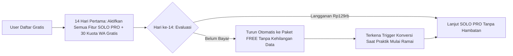

# 06 - SaaS Pricing, Freemium Funnel & Monetization Strategy

**Target Market:** Dokter Gigi Praktik Mandiri (TPMDG), Dokter Gigi Estetik/Associate, & Klinik Gigi Pratama/Utama di Indonesia.  
**Core Pricing Philosophy:** *"Harga sepertiga dari 1x tindakan Scaling, namun menghasilkan puluhan pasien baru setiap bulan."*

---

## 1. Benchmark Pasar Indonesia & Positioning

Berdasarkan data pasar aplikasi klinik dan RME gigi di Indonesia:
- **Kompetitor Praktik Mandiri:** Rp175.000 – Rp285.000 / bulan (*Dental Diary, Klinik Pintar, Klinikita*).
- **Kompetitor Skala Klinik:** Rp300.000 – Rp800.000 / bulan (*Assist.id, Medisy, DIGMAN*).
- **Positioning Kita:** 
  1. Menawarkan **Freemium Permanen** sebagai *viral loop* akuisisi dokter gigi muda (lewat fitur *Personal Dental Microsite / Link-in-Bio*).
  2. Memasang harga *Entry Paid Tier* di angka psikologis **Rp129.000/bulan** (atau **Rp99.000/bulan** pada pembayaran tahunan) agar menjadi pilihan paling *no-brainer* bagi dokter gigi mandiri.

---

## 2. Arsitektur 4-Tier Pricing (Dengan Psikologi *Price Anchoring*)

```
+---------------------------------------------------------------------------------------------------+
| TIER 1: FREE (STARTER) | TIER 2: SOLO PRO ⭐     | TIER 3: CLINIC GROWTH  | TIER 4: CLINIC PRO    |
| Rp 0 (Selamanya)       | Rp 129.000 / bln        | Rp 349.000 / bln       | Rp 699.000 / bln      |
|                        | (Rp 99.000/bln Tahunan) | (Rp 279.000/bln Thnan) | (Rp 549.000/bln Thnan)|
+------------------------+-------------------------+------------------------+-----------------------+
| Untuk drg. baru /      | Untuk Praktik Mandiri   | Untuk Klinik Gigi      | Untuk Klinik Ramai &  |
| Associate (Personal    | (TPMDG) yang ingin      | Multi-Dokter (1-3      | Multi-Cabang          |
| Branding & RME Dasar)  | bebas antre & otomatis  | Kursi Gigi)            |                       |
+---------------------------------------------------------------------------------------------------+
```

### Matriks Fitur & Batasan Kuota per Tier

| Fitur / Kapasitas | **FREE (Starter)** | **SOLO PRO (Rp129rb)** | **CLINIC GROWTH (Rp349rb)** | **CLINIC PRO (Rp699rb)** |
| :--- | :--- | :--- | :--- | :--- |
| **Jumlah Dokter Gigi** | 1 Dokter | 1 Dokter (+1 Akun Perawat) | s/d **5 Dokter Gigi** | **Unlimited Dokter** |
| **Jumlah Kursi (*Dental Chair*)** | 1 Kursi | 1 Kursi (Multi-Lokasi Praktik) | s/d **3 Kursi Gigi** | **Unlimited Kursi** |
| **Kuota Kunjungan / RME** | **Maks. 25 / bulan** | **Unlimited Kunjungan** | **Unlimited Kunjungan** | **Unlimited Kunjungan** |
| **Landing Page Builder** | 1 Halaman Dasar (*Ada Watermark SaaS*) | Full Blok + Slider *Before-After* (Tanpa Watermark) | Full Blok + Profil Multi-Dokter + Custom Domain | Multi-Landing Page per Cabang + Custom Domain |
| **Booking Online & Anti-Ghosting** | Booking Manual ke WA | Smart Slot + **Deposit QRIS Otomatis** | Smart Slot + Deposit QRIS + Kalender *Chair-Grid* | Prioritas + Integrasi Meta Pixel / Google Ads |
| **Kuota WhatsApp Otomatis** | ❌ (Klik Manual ke WA Web) | **150 Pesan WA / bulan** (Reminder & Kwitansi) | **500 Pesan WA / bulan** (Reminder + Recall 6 Bln) | **1.500 Pesan WA / bln** + *Custom Sender Number* |
| **Odontogram & Klinis** | Odontogram Dasar + SOAP | **3-Tap Odontogram-to-Billing** + *Presentation Mode* + *Digital Consent* | Semua Fitur Solo Pro + Tracking Order **Lab Gigi** | Semua Fitur + Analitik Performa Klinis |
| **Kasir, Cicilan & Komisi** | Kasir Dasar (Tunai/QRIS) | Kasir + Tracking Cicilan Pasien (*Behel/PSA*) | **Mesin Hitung Komisi Dokter & Perawat Otomatis** | Komisi Multi-Skema + Laporan Laba Rugi Cabang |
| **Storage Foto & Rontgen** | 250 MB Total | 5 GB (Auto-WebP) | 25 GB (Auto-WebP) | 100 GB (Auto-WebP) |

---

## 3. Strategi Konversi Terbaik: "Reverse Trial + Contextual Paywall"

Jangan gunakan model Freemium pasif di mana user hanya diberi fitur timpang sejak hari pertama (rata-rata konversi hanya ~3%). Gunakan strategi **14-Day Reverse Trial into Freemium** (konversi mencapai **8% – 14%**):



### 5 Pemicu Konversi (*Conversion Triggers*) Paling Efektif:

1. **The "26th Patient" Paywall (Momentum Nilai Ekonomi):**
   - Di paket Gratis, dokter mendapat kuota **25 kunjungan RME/booking per bulan** (sekitar 1 pasien per hari kerja).
   - Saat pasien ke-26 datang di bulan yang sama, dokter tersebut sudah mengantongi omzet sekitar **Rp7.500.000 – Rp12.000.000** dari 25 pasien sebelumnya.
   - Muncul *Contextual Prompt* di layar: *"Selamat Dok! Praktik Anda sudah melayani 25 pasien bulan ini. Upgrade ke Solo Pro hanya Rp129.000 (setara 1/3 tarif Scaling) untuk membuka kunjungan tanpa batas."* $\rightarrow$ Tingkat konversi sangat tinggi karena dokter sedang memegang uang hasil praktik.

2. **The "Ghosting / No-Show" Pain Trigger:**
   - Di paket Gratis, pasien yang booking online tidak ditarik DP QRIS otomatis dan tidak dikirimi pengingat WA otomatis H-1.
   - Saat dokter mengklik status jadwal menjadi `NO_SHOW` (Pasien Batal Datang), sistem langsung menampilkan *pop-up* empatik: *"Kesal kursi kosong karena pasien tidak datang? Aktifkan **Deposit QRIS Otomatis & WA Reminder H-1** di paket Solo Pro untuk memangkas pasien ghosting hingga 80%."*

3. **The "WhatsApp Click Fatigue" Trigger:**
   - Di paket Gratis, setiap selesai pemeriksaan atau konfirmasi jadwal, dokter/admin harus mengklik tombol `Kirim WA Manual` yang membuka tab *WhatsApp Web* satu per satu.
   - Untuk *Recall* 6 bulan (pasien Scaling), sistem menampilkan notifikasi di Dashboard: *"Ada 18 pasien Anda yang sudah waktunya Scaling ulang bulan ini (Potensi Omzet: Rp6.300.000). Upgrade ke Solo Pro agar sistem mengirimkan undangan WA otomatis ke mereka sekarang!"*

4. **The "Aesthetic Prestige & Watermark" Trigger:**
   - Dokter gigi sangat peduli pada citra profesional di Instagram/TikTok. Paket Gratis menampilkan *sticky badge* kecil di bawah Landing Page: `Powered by [NamaSaaS] - Buat Web Dokter Gigi Gratis`.
   - Selain berfungsi sebagai **iklan gratis (Viral Loop)** ke dokter gigi lain yang melihat profil tersebut, dokter yang ingin tampil eksklusif akan rela membayar Rp99rb–Rp129rb/bulan demi menghapus *watermark* dan membuka fitur **Before-After Image Slider**.

5. **The "Associate Doctor & Commission" Trigger (Upgrading Solo $\rightarrow$ Clinic):**
   - Begitu seorang dokter praktik mandiri mulai kewalahan dan mengajak 1 teman sejawatnya untuk ikut praktik bergantian di kursinya, ia butuh menghitung bagi hasil (*fee* dokter).
   - Fitur **Tambah Dokter Ke-2** dan **Kalkulator Komisi Otomatis** dikunci eksklusif di **Tier Clinic Growth (Rp349.000/bulan)**. Ini menciptakan *Net Revenue Retention (NRR) > 120%* seiring tumbuhnya bisnis pelangganmu.

---

## 4. Unit Economics & Proteksi Margin (Penting untuk SaaS Rp100 Ribuan!)

Jika kamu menjual paket seharga **Rp99.000 – Rp129.000/bulan**, kamu harus menjaga agar *Cost of Goods Sold (COGS)* per tenant tidak melebihi **Rp20.000/bulan** (Gross Margin > 80%). Dua komponen biaya variabel yang wajib dikendalikan adalah:

### A. Pengendalian Biaya WhatsApp Gateway
- **Masalah:** API WhatsApp memiliki biaya per pesan atau biaya langganan per nomor.
- **Solusi Arsitektur & Monetisasi:**
  1. Gunakan *Shared Official WhatsApp Notification Number* milik platform kamu untuk mengirimkan pengingat jadwal & kwitansi, dengan **kuota terukur** (150 pesan/bulan di Solo Pro = ~3 pesan per kunjungan untuk 50 pasien).
  2. Jika kuota habis, jual **Add-On Token WhatsApp** (Rp35.000 untuk 250 pesan tambahan, tidak hangus di akhir bulan).
  3. Untuk klinik besar yang ingin menggunakan nomor WA klinik mereka sendiri (*Custom Masking/Sender*), jadikan fitur di **Tier Clinic Pro** atau *Add-On* seharga Rp100.000/bulan.

### B. Pengendalian Biaya Cloud Storage (Foto Gigi & Rontgen)
- **Masalah:** Kamera intraoral dan HP dokter menghasilkan foto berukuran 5–10 MB per lembar.
- **Solusi Teknis:**
  1. **Client-Side WebP Compression:** Sebelum foto diunggah ke server, kompres otomatis di browser/tablet menggunakan `browser-image-compression` menjadi format **WebP** resolusi medis optimal (~150–250 KB per foto, hemat 95% ruang penyimpanan!).
  2. Gunakan **Cloudflare R2** (biaya *bandwidth egress* Rp0 alias gratis saat foto dibuka berulang kali oleh dokter, jauh lebih murah dibanding AWS S3).

### C. Monetisasi Tambahan dari Fintech (Payment Gateway Fee)
- Saat pasien membayar **Deposit Booking QRIS** di Landing Page atau melunasi tagihan via QRIS Dinamis, kenakan *Platform Convenience Fee* sebesar **Rp1.500 – Rp2.500 per transaksi sukses** (dapat diatur di dashboard apakah ditanggung oleh pasien sebagai *Biaya Admin Booking* atau dipotong dari klinik).
- Dengan 50 transaksi booking per bulan, kamu mendapatkan tambahan *revenue* Rp100.000/klinik di luar biaya langganan bulanan!

---

## 5. Tambahan Skema Database untuk Subscription & Feature Gating

Tambahkan 2 tabel berikut ke dalam skema PostgreSQL (`02-DATABASE-SCHEMA-AND-ERD.md`) untuk mengelola batasan paket secara *real-time*:

```sql
CREATE TABLE tenant_subscriptions (
    id UUID PRIMARY KEY DEFAULT gen_random_uuid(),
    tenant_id UUID UNIQUE NOT NULL REFERENCES tenants(id) ON DELETE CASCADE,
    plan_tier VARCHAR(30) NOT NULL DEFAULT 'FREE' 
        CHECK (plan_tier IN ('FREE', 'SOLO_PRO', 'CLINIC_GROWTH', 'CLINIC_PRO')),
    billing_cycle VARCHAR(20) DEFAULT 'MONTHLY' CHECK (billing_cycle IN ('MONTHLY', 'YEARLY')),
    is_reverse_trial BOOLEAN DEFAULT TRUE, -- True selama 14 hari pertama pendaftaran
    trial_ends_at TIMESTAMPTZ,
    current_period_end TIMESTAMPTZ,
    -- Hard Limits per Tenant (Bisa di-override jika beli Add-On)
    max_doctors INT NOT NULL DEFAULT 1,
    max_chairs INT NOT NULL DEFAULT 1,
    monthly_encounter_limit INT DEFAULT 25, -- NULL = Unlimited
    monthly_wa_quota INT NOT NULL DEFAULT 0,
    addon_wa_credits INT NOT NULL DEFAULT 30, -- Bonus 30 WA saat onboarding
    storage_limit_mb INT NOT NULL DEFAULT 250,
    updated_at TIMESTAMPTZ DEFAULT NOW()
);

CREATE TABLE tenant_usage_counters (
    id UUID PRIMARY KEY DEFAULT gen_random_uuid(),
    tenant_id UUID NOT NULL REFERENCES tenants(id) ON DELETE CASCADE,
    year_month VARCHAR(7) NOT NULL, -- Format: '2026-10'
    encounters_count INT NOT NULL DEFAULT 0,
    wa_messages_sent INT NOT NULL DEFAULT 0,
    storage_used_mb NUMERIC(10,2) NOT NULL DEFAULT 0,
    UNIQUE(tenant_id, year_month)
);
```
